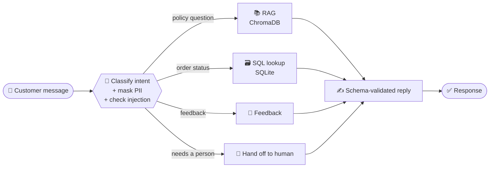

<!-- ===================== HEADER ===================== -->

 

<!--
FILL IN OR DELETE before publishing (only add what you can state exactly):
- 🏭 [Your role], Tesla Gigafactory Berlin, [month year to month year]
-->

---

## 👋 About me

I build the retrieval, tool-routing and safety layers around LLMs, and I write down what each system **cannot** do as clearly as what it can.

| | |
|---|---|
| 🎓 **Studying** | B.Sc. Software Engineering, University of Europe for Applied Sciences |
| 🧠 **Fellowship** | IIT Roorkee Agentic AI Systems & Design cohort 🥈 Excellence in Evaluation (Silver) · 🥇 Total Engagement (Gold) |
| 🔭 **Now** | Evaluating agents with real models, learning tracing and observability |
| 🌍 **Based in** | Berlin |

---

## 🧭 How I build

<table>
<tr>
<td align="center" width="33%">
<h3>🎯 Grounded</h3>
Answers come from retrieved documents or real database rows, not from guesses.
</td>
<td align="center" width="33%">
<h3>🛡️ Guarded</h3>
Masking, injection checks and schema-validated output sit around the model.
</td>
<td align="center" width="33%">
<h3>📝 Honest</h3>
Every README says what is synthetic, what is mocked and what is still missing.
</td>
</tr>
</table>

---

## 🚀 Featured project: Cartmind

> **An e-commerce support agent that answers from real policy documents and real order records.**

| 🔀 Graph | 📄 Knowledge base | 🗄️ Data | 🧪 Evaluation |
|:---:|:---:|:---:|:---:|
| **6 nodes** 5 routing branches | **38** policy PDFs | **50** synthetic orders | **15** test queries |

- 🔒 Phone and card-number masking, prompt-injection detection, JSON-Schema-checked answers
- ♻️ SQLite checkpoints let an interrupted run resume
- 🔌 FastAPI backend and an MCP server
- 🔑 Runs with **no API key** (`MOCK_LLM=true`). All data is synthetic.

[**👉 View the repository**](https://github.com/YS-Pundir/cartmind-agentic-ecommerce-support)

---

## 🗂️ More projects

<table>
<tr>
<td width="50%" valign="top">

### 🤖 [Agentic-Support-System](https://github.com/YS-Pundir/Agentic-Support-System)
A support bot where one orchestrator agent delegates to a **RAG agent**, a **text-to-SQL agent**, and feedback and escalation tools. Prompts and model settings are versioned files.

</td>
<td width="50%" valign="top">

### 🏛️ [Sindhu-RAG](https://github.com/YS-Pundir/Sindhu-RAG)
A configurable RAG pipeline over a **200+ page** corpus on the Indus Valley Civilization, with config-tracked experiments, versioned prompts and a Streamlit test UI.

</td>
</tr>
<tr>
<td width="50%" valign="top">

### 🏠 [Geo-Spatial Valuation Regressor](https://github.com/YS-Pundir/geo-spatial-valuation-regressor)
Linear vs ensemble models for predicting California property values.

</td>
<td width="50%" valign="top">

### 🩺 [Clinical Tumor Classifier](https://github.com/YS-Pundir/clinical-tumor-classifier)
Threshold tuning for malignant tumor detection, evaluated with a confusion matrix and ROC-AUC.

</td>
</tr>
<tr>
<td colspan="2" valign="top">

### 📈 [Stock Market EDA Pipeline](https://github.com/YS-Pundir/EDA-snack-app-stock-market)
Pulls stock data from the Alpha Vantage API, cleans it with Pandas and visualizes it.

</td>
</tr>
</table>

---

## 🛠️ Tools I use in these projects

---

## 📊 GitHub snapshot

---

## 🎯 What's next

- [ ] Run my agents against real models and publish the scores
- [ ] Replace keyword intent routing with a measured classifier
- [ ] Learn LLM tracing and observability
- [ ] Contribute to open-source AI tooling

---

**Want to talk agents, RAG or backend design?**

